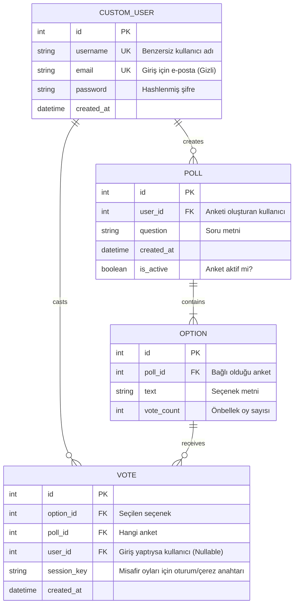
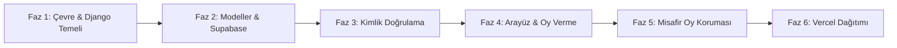

# 🗳️ Kararsızım - Proje Planı & Geliştirme Rehberi

Bu belge, **Kararsızım** uygulamasının mimarisini, teknik detaylarını ve aşamalı (faz bazlı) geliştirme yol haritasını içerir.

---

## 📌 1. Proje Özeti & Temel Kurallar

- **Proje Adı:** Kararsızım
- **Amacı:** Kullanıcıların kararsız kaldığı konularda (örneğin: *"Bugün sinemaya mı gitsem, restorana mı?"*) topluluğa danışıp anket açabildiği ve diğer kullanıcıların oy verebildiği hafif, sade bir web platformu.
- **Takip Mekanizması Yok:** Takipçi, arkadaş listesi vb. karmaşık sosyal özellikler yoktur. Açılan tüm anketler genel bir akışta (feed) listelenir.
- **Misafir (Anonim) Özgürlüğü:** Üye olmayan kullanıcılar tüm anketleri listeleyebilir, detaylarını görebilir ve oy kullanabilir.
- **Anket Açma Yetkisi:** Yeni anket oluşturmak için üye olmak ve giriş yapmak zorunludur.
- **Kullanıcı Gizliliği & Kimlik:**
  - Kayıtta e-posta ve benzersiz (`unique`) **kullanıcı adı** istenir.
  - Anketlerde ve arayüzde sadece **kullanıcı adı** görünür; e-posta adresi asla herkese açık sergilenmez.
- **Seçenek Kuralları:**
  - Her anket **en az 2**, **en fazla 5** seçenek içerebilir.

---

## 🛠️ 2. Teknoloji Yığını (Tech Stack)

| Katman | Teknoloji | Açıklama |
| :--- | :--- | :--- |
| **Backend** | Python 3.11+, Django | Hızlı prototipleme, yerleşik auth ve ORM avantajı. |
| **Veritabanı** | Supabase (PostgreSQL) | Bulut tabanlı PostgreSQL (Connection Pooler ile Vercel uyumlu). |
| **Frontend** | HTML5, Modern CSS, Vanilla JS | Ayrı bir SPA framework'ü (React/Vue) olmadan hafif ve hızlı Django Templates. |
| **Deployment** | Vercel | Serverless Python WSGI dağıtımı (`@vercel/python`). |
| **Statik Dosyalar** | WhiteNoise | CSS/JS dosyalarını ek bir bulut depolama gerektirmeden Vercel üzerinde sunar. |

---

## 🗄️ 3. Veri Modeli Tasarımı (Database Schema)

---

## 🚀 4. Aşamalı Geliştirme Yol Haritası (Fazlar)

---

### 🟢 FAZ 1: Geliştirme Ortamı & Django İskeleti
- **Amaç:** Proje dizini, Python sanal ortamı (`venv`), temel kütüphaneler ve Django projesinin ayağa kaldırılması.
- **Yapılacaklar:**
  1. Python sanal ortamı oluşturulması ve aktif edilmesi.
  2. `django`, `psycopg2-binary`, `dj-database-url`, `python-dotenv`, `whitenoise` paketlerinin kurulması.
  3. `kararsizim` Django projesinin ve `polls` ile `accounts` uygulamalarının oluşturulması.
  4. `.env` ve `.gitignore` dosyalarının yapılandırılması.

---

### 🟢 FAZ 2: Veritabanı Modelleri & Supabase Entegrasyonu
- **Amaç:** Supabase PostgreSQL veritabanına bağlanmak ve anket/seçenek modellerini oluşturmak.
- **Yapılacaklar:**
  1. Supabase bağlantı URI'sinin (`DATABASE_URL`) `.env` dosyasına tanımlanması.
  2. `User` (veya standart Django auth), `Poll`, `Option` ve `Vote` modellerinin yazılması.
  3. En az 2, en çok 5 seçenek validasyonlarının model seviyesinde yazılması.
  4. `makemigrations` ve `migrate` ile tabloların Supabase üzerinde oluşturulması.

---

### 🟢 FAZ 3: Kullanıcı Kimlik Doğrulama (Accounts)
- **Amaç:** Anket açabilmek için gerekli olan üyelik akışının tamamlanması.
- **Yapılacaklar:**
  1. Kayıt Ol (Register) formu: E-posta, Benzersiz Kullanıcı Adı, Şifre.
  2. Giriş Yap (Login) & Çıkış Yap (Logout) sayfaları.
  3. Yetki kontrolleri: Giriş yapmamış kullanıcı anket aç butonuna basarsa doğrudan login sayfasına yönlendirilecek.

---

### 🟢 FAZ 4: Frontend Arayüzü & Anket Akışı
- **Amaç:** Vanilla HTML, temiz modern CSS ve JS ile responsive, sade bir prototip arayüz oluşturmak.
- **Yapılacaklar:**
  1. `base.html`: Modern, mobil uyumlu header, footer ve minimalist kart tasarımı.
  2. `index.html` (Ana Sayfa): Herkesin görebildiği kronolojik anket listesi, oy oranları çubukları.
  3. `create_poll.html`: Dinamik seçenek ekleme/silme (JavaScript ile `+ Seçenek Ekle`, min 2, maks 5 sınırlaması).
  4. `poll_detail.html`: Anket detay sayfası ve seçenek tıklayarak oy verme arayüzü.

---

### 🟢 FAZ 5: Oy Kullanma Mekanizması & Misafir Koruması
- **Amaç:** Hem üye olanların hem de misafirlerin adil bir şekilde oy kullanabilmesi, mükerrer oyların engellenmesi.
- **Yapılacaklar:**
  1. Giriş yapmış kullanıcılar için: `Vote` kaydında `user_id` kontrolü ile 1 ankete 1 oy hakkı.
  2. Misafir (Anonim) kullanıcılar için: Django `session_key` veya tarayıcı çerezi üzerinden mükerrer oy engelleme.
  3. Oy kullanıldıktan sonra sonuçların anlık yüzde ve oy sayıları şeklinde gösterilmesi.

---

### 🟢 FAZ 6: Vercel Deployment & Canlıya Alma
- **Amaç:** Uygulamanın Vercel üzerinde sorunsuz bir şekilde canlıya alınması.
- **Yapılacaklar:**
  1. `vercel.json` dosyasının konfigüre edilmesi (`@vercel/python` ve `wsgi.py` yönlendirmesi).
  2. WhiteNoise ile statik dosyaların derlenmesi (`collectstatic`).
  3. Vercel üzerinde `DATABASE_URL`, `SECRET_KEY`, `DEBUG=False` ortam değişkenlerinin ayarlanması.
  4. Canlı test ve doğrulama.

---

## 💬 5. Sıradaki Adımlarda Kullanabileceğin Hazır AI Promptları

İstediğin zaman aşağıdaki promptları kopyalayarak bana gönderebilirsin:

#### 🔹 Faz 1 Başlatma Promptu:
> *"Kararsızım projesinin Faz 1'ine başlayalım. Gerekli Python sanal ortamını kuralım, Django ve gerekli kütüphaneleri yükleyip temel proje iskeletini oluşturalım."*

#### 🔹 Faz 2 Başlatma Promptu:
> *"Faz 2'ye geçelim. Supabase PostgreSQL bağlantı ayarlarını yapalım, Poll, Option ve Vote modellerini (min 2, max 5 seçenek kuralıyla birlikte) yazıp migration işlemlerini tamamlayalım."*

#### 🔹 Faz 3 Başlatma Promptu:
> *"Faz 3'e geçelim. Kullanıcıların e-posta ve benzersiz kullanıcı adı ile kayıt olabileceği, giriş ve çıkış yapabileceği kimlik doğrulama sistemini oluşturalım."*

#### 🔹 Faz 4 Başlatma Promptu:
> *"Faz 4'e geçelim. Django template'leri, modern ve sade CSS ile ana sayfa anket akışını, dinamik seçenek eklemeli anket oluşturma sayfasını ve anket detay görünümünü tasarlayalım."*

#### 🔹 Faz 5 Başlatma Promptu:
> *"Faz 5'e geçelim. Hem üyelerin hem de misafirlerin tek bir oy kullanabileceği oy verme mekanizmasını ve anket sonuç hesaplamalarını entegre edelim."*

#### 🔹 Faz 6 Başlatma Promptu:
> *"Faz 6'ya geçelim. Vercel deployment ayarlarını (vercel.json, wsgi, whitenoise ve environment variables) yapılandırıp canlıya dağıtıma hazır hale getirelim."*
